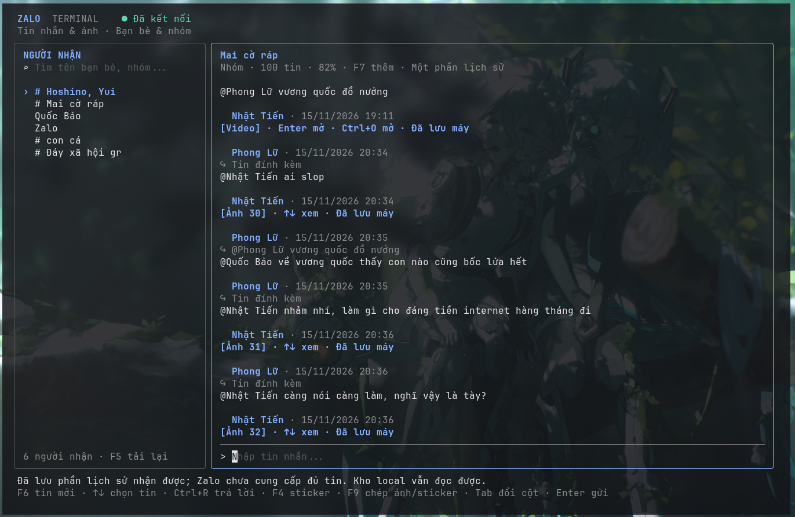

# Zalo CLI

Zalo CLI là ứng dụng dòng lệnh không chính thức để đọc và gửi tin nhắn Zalo trên Linux. Dự án có giao diện chat tương tác trong terminal và các lệnh để liệt kê hội thoại hoặc gửi tin nhắn.

## Demo



## Tính năng

- Đăng nhập bằng mã QR và dùng lại phiên đăng nhập đã lưu.
- Đọc và gửi tin nhắn trong hội thoại cá nhân hoặc nhóm qua giao diện terminal hoặc câu lệnh.
- Lưu lịch sử tin nhắn bằng SQLite để đọc lại dữ liệu đã đồng bộ.

## Chạy trên Linux

Cần Go 1.27.2 trở lên, Node.js 22 và npm. Để tự mở ảnh QR khi đăng nhập lần đầu, máy cần có `xdg-open` và ứng dụng xem ảnh.

Từ thư mục gốc của repo:

```bash
npm --prefix daemon ci
go build -o ./zalo-cli ./cmd/zalo-cli
./zalo-cli -tui
```

CLI sẽ tự khởi động daemon nếu chưa chạy. Khi được yêu cầu, quét mã QR bằng Zalo trên điện thoại. Nếu ảnh không tự mở, mở `daemon/qr.png` sau khi daemon tạo file.

```bash
./zalo-cli -help
./zalo-cli -list
./zalo-cli -list -text "Xin chào!"
```

Lệnh cuối cho phép chọn người nhận trước khi gửi.

## Kiến trúc

- **Go + Bubble Tea** dựng giao diện terminal và gửi lệnh JSON qua WebSocket tại `127.0.0.1:8989`.
- **Node.js + zca-js** quản lý đăng nhập, nhận sự kiện từ Zalo và xử lý yêu cầu từ CLI. Daemon có thể tiếp tục lưu tin nhắn sau khi người dùng đóng giao diện.
- **SQLite** lưu lịch sử theo tài khoản, mặc định ở `~/.local/share/zalo-cli/accounts/` hoặc dưới `$XDG_DATA_HOME/zalo-cli/accounts/` nếu biến này được cấu hình.

Phiên đăng nhập nằm ở `daemon/session.json`. Khi chia sẻ mã nguồn hoặc quay demo, giữ file phiên, ảnh QR và dữ liệu chat cá nhân ở máy local.
