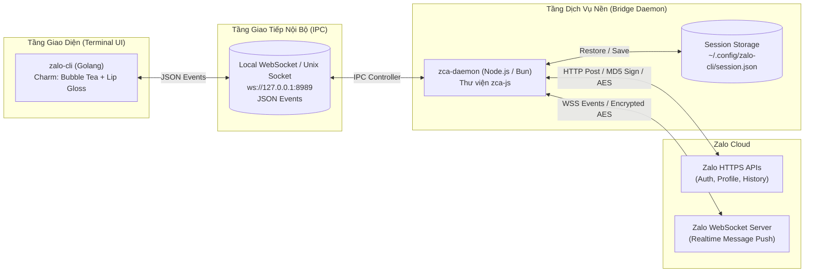

# ZALO CLI — KẾ HOẠCH TRIỂN KHAI & TÀI LIỆU KIẾN TRÚC THỰC CHIẾN

> **Tôn chỉ dự án:** *"Vừa làm, vừa hiểu sâu bản chất hệ thống"* — Đi từng bước micro-step 15–30 phút, ưu tiên nguyên mẫu chạy được trước (Pragmatic Execution), sau đó mở rộng và tối ưu dần sang Native Golang.

---

## 1. Mục tiêu Dự án & Giá trị Học tập (Learning Outcomes)

Dự án này được thiết kế riêng cho lộ trình **Junior / Fresher Golang Backend & DevOps / Systems Engineer**, giúp Bảo trang bị tư duy hệ thống thực tế thông qua việc giải quyết bài toán: **Nhắn tin Zalo trực tiếp trong Terminal Linux (`Konoha`) mà không cần mở trình duyệt hay app GUI nặng nề.**

### 🎯 5 Khối kiến thức cốt lõi sẽ làm chủ:
1. **Kiến trúc Client – Daemon & IPC (Inter-Process Communication):**
   - Hiểu sâu mô hình phân tách giữa UI Process (CLI) và Background Service (Daemon) tương tự `docker` vs `dockerd`, `tmux client` vs `tmux server`.
   - Làm chủ cơ chế truyền thông nội bộ qua **Local WebSocket** hoặc **Unix Domain Socket** với độ trễ nano-giây.
2. **Lập trình Đồng thời (Go Concurrency Mastery):**
   - Quản lý vòng đời tiến trình với `context.Context` (graceful shutdown, cancellation).
   - Truyền nhận dữ liệu realtime giữa network goroutine và UI thread bằng `chan` (buffered/unbuffered channels) và `select`.
3. **Kỹ thuật Terminal UI với Hệ sinh thái Charm:**
   - Nắm vững kiến trúc **Elm Architecture** trong `bubbletea` (`Init` -> `Update` -> `View`).
   - Tự tay tạo giao diện dòng lệnh đẹp mắt, phân chia layout dạng cột/chia ô với `lipgloss`, hộp nhập tin nhắn với `bubbles/textinput`, vùng cuộn tin nhắn với `bubbles/viewport`.
4. **Hiểu sâu Giao thức Mạng & Reverse-Engineering:**
   - Hiểu cách các nền tảng chat mã hóa gói tin: AES-CBC, AES-GCM, chữ ký MD5 chống giả mạo, zlib nén dữ liệu.
   - Quản lý phiên làm việc (Session/Cookies), duy trì kết nối WebSocket bền bỉ (Keep-Alive, Ping/Pong, Auto-reconnect với Exponential Backoff).
5. **DevOps & Tích hợp Hệ điều hành Linux:**
   - Quản lý tiến trình nền (Background Daemon management), tự động spawn process ngầm hoặc đóng gói dưới dạng **systemd user service**.
   - Bắn thông báo đẩy Desktop trên Linux thông qua `notify-send` / D-Bus.

---

## 2. Kiến trúc Hệ thống (System Architecture)

### 2.1 Sơ đồ Luồng Dữ liệu (Data Flow)



### 2.2 Đặc tả Giao thức IPC (JSON Message Protocol)

Hai tiến trình giao tiếp qua JSON phẳng, rõ ràng, dễ debug:

#### 1. Lệnh từ Go CLI gửi sang Daemon (`CLI -> Daemon`):
```json
{
  "id": "req-1",
  "action": "send_message",
  "payload": {
    "thread_id": "84912345678",
    "thread_type": "user",
    "text": "Chào bạn, mình gửi từ Zalo CLI!"
  }
}
```

#### 2. Sự kiện từ Daemon bắn về Go CLI (`Daemon -> CLI`):
```json
{
  "event": "new_message",
  "data": {
    "msg_id": "1729000000",
    "sender_id": "84912345678",
    "sender_name": "Quốc Bảo",
    "content": "Alo, test CLI nhé!",
    "timestamp": 1729000000000,
    "is_self": false
  }
}
```

---

## 3. Cấu trúc Thư mục Dự án

```
zalo-cli/
├── AGENTS.md                  # Quy tắc bắt buộc của Agent
├── COMMAND_LOG.md             # Nhật ký lệnh thực thi terminal
├── CHANGELOG.md               # Nhật ký thay đổi mã nguồn
├── plan.md                    # Tài liệu kiến trúc & Kế hoạch (file này)
│
├── cmd/
│   └── zalo-cli/              # Entrypoint của ứng dụng Go CLI
│       └── main.go
│
├── internal/                  # Mã nguồn Go riêng tư (Internal Packages)
│   ├── app/                   # Khởi tạo App, quản lý vòng đời CLI
│   ├── config/                # Đọc cấu hình (~/.config/zalo-cli/config.yaml)
│   ├── ipc/                   # Client WebSocket/Socket kết nối tới Daemon
│   │   ├── client.go          # Quản lý kết nối, tự động reconnect
│   │   ├── protocol.go        # Định nghĩa Struct các gói tin JSON
│   │   └── worker.go          # Goroutine lắng nghe event stream
│   ├── models/                # Struct dữ liệu: User, Message, Conversation
│   └── tui/                   # Giao diện Terminal (Charm Bubble Tea)
│       ├── model.go           # Bubble Tea Model (State trung tâm)
│       ├── update.go          # Xử lý sự kiện bàn phím & IPC messages
│       ├── view.go            # Render giao diện bằng Lip Gloss
│       ├── sidebar.go         # Component danh sách bạn bè / nhóm chat
│       └── chatview.go        # Component hiển thị tin nhắn & hộp nhập
│
├── daemon/                    # Bridge Daemon viết bằng TypeScript (Bun/Node)
│   ├── package.json
│   ├── tsconfig.json
│   ├── src/
│   │   ├── index.ts           # Entrypoint: khởi động socket server & zalo worker
│   │   ├── zalo.ts            # Wrapper zca-js (login QR, listen, send)
│   │   ├── server.ts          # Local WebSocket Server phục vụ Go CLI
│   │   └── storage.ts         # Lưu & nạp session/cookies từ disk
│   └── dist/
│
└── Makefile                   # Các lệnh build, run, dev, test tiện lợi
```

---

## 4. Kế hoạch Triển khai theo Micro-Steps (15–30 phút/bước)

---

### 🟢 PHASE 0: Khởi tạo Workspace & Chuẩn bị Môi trường (Ước tính: 20 phút)

* **Mục tiêu:** Dựng khung repo sạch sẽ, thiết lập Git chuẩn Conventional Commits và kiểm tra công cụ sẵn có trên hệ thống Linux `Konoha`.
* **Kiến thức cần nắm:** Quy tắc tổ chức dự án chuẩn của Golang (`cmd/` và `internal/`) và quản lý đa ngôn ngữ (Go + Bun/Node trong cùng repo).

- [x] **Step 0.1:** Khởi tạo Git repository, cấu hình `.gitignore` chuẩn (bỏ qua `node_modules`, `dist`, binary Go, session cookies nhạy cảm).
- [ ] **Step 0.2:** Kiểm tra môi trường hệ thống (`go version`, `bun -v` hoặc `node -v`). Khởi tạo `go.mod` với module name `github.com/sweetvn/zalo-cli`.
- [ ] **Step 0.3:** Dựng khung thư mục: `cmd/zalo-cli`, `internal/...`.

---

### 🟡 PHASE 1: Xây dựng Bridge Daemon (`daemon/`) — Cầu nối Zalo (Ước tính: 60 phút) — [ĐÃ HOÀN THÀNH 100%]

* **Mục tiêu:** Có một tiến trình Node.js chạy được ngầm, đăng nhập Zalo bằng mã QR hiển thị ngay trên Kitty Terminal, lưu session an toàn và mở cổng WebSocket local để Go kết nối.
* **Kiến thức đã nắm:** Cách `zca-js` xử lý chuỗi QR, lưu trữ session ra file, mở WebSocketServer trên cổng 8989, cơ chế broadcast event JSON sang IPC client.

- [x] **Step 1.1:** Setup thư mục `daemon/`, cài đặt thư viện `zca-js`, `ws`.
- [x] **Step 1.2:** Viết logic `daemon/index.mjs` xử lý đăng nhập QR (hiển thị ảnh PNG gốc qua `kitten icat`), lưu session vào `session.json` để tự khôi phục phiên sau này.
- [x] **Step 1.3:** Dựng Local WebSocket Server (`ws://127.0.0.1:8989`):
  - Lắng nghe sự kiện `message` từ `zca-js` và broadcast JSON (`new_message`) về cho Go client.
  - Sẵn sàng đón nhận lệnh `send_message` từ Go client để gọi `api.sendMessage` của `zca-js`.

---

### 🟠 PHASE 2: Xây dựng Go IPC Client & Concurrency Engine (Ước tính: 45 phút)

* **Mục tiêu:** Viết module Golang kết nối vào Local WebSocket của Daemon, dùng Goroutine + Channel để hứng sự kiện tin nhắn liên tục mà không làm treo app.
* **Kiến thức cần nắm:** Go Channels (buffered vs unbuffered), Worker Goroutines, cơ chế xử lý JSON dynamic/typed trong Go.

- [x] **Step 2.1 (15m):** Cài đặt package WebSocket cho Go (`github.com/gorilla/websocket`). Định nghĩa các Go Structs trong `internal/ipc/protocol.go` để serialize/deserialize JSON.
- [x] **Step 2.2 (20m):** Viết `internal/ipc/client.go`:
  - Goroutine đọc (`readPump`): Đọc liên tục các message từ WebSocket và bắn vào một Go Channel `chan ipc.Event`.
  - Hàm `SendMessage(threadID, text string) error` gửi payload qua socket.
- [x] **Step 2.3 (10m):** Viết file `cmd/zalo-cli/main.go` thử nghiệm: Chạy Go CLI, in tin nhắn nhận được ra terminal dạng log text thô để kiểm chứng 100% đường truyền hoạt động.

---

### 🔵 PHASE 3: Thiết kế Giao diện Terminal TUI với Charm (Ước tính: 75 phút)

* **Mục tiêu:** Tạo giao diện Terminal hiện đại, chia 2 cột: Cột trái danh sách hội thoại, cột phải hiển thị lịch sử chat và ô soạn thảo tin nhắn.
* **Kiến thức cần nắm:** The Elm Architecture (`Init`, `Update`, `View`), cách sử dụng `lipgloss` để căn lề (padding, margin, border, color), và cách tích hợp `tea.Cmd` để lắng nghe Go Channel bất đồng bộ.

- [x] **Step 3.1 (25m): Dựng Layout Cơ bản & Phối màu Lip Gloss**
  - Khởi tạo Bubble Tea model chính trong `internal/tui/model.go`.
  - Phân vùng màn hình: Title bar trên cùng, 2 cột chính ở giữa, Status bar dưới cùng hiển thị phím tắt (`Tab: đổi cột`, `Esc: thoát`, `Enter: gửi`).
- [x] **Step 3.2 (25m): Tích hợp Input & Viewport cuộn tin nhắn**
  - Dùng `bubbles/textinput` cho hộp soạn tin nhắn ở góc dưới bên phải.
  - Dùng `bubbles/viewport` để render danh sách tin nhắn chat, hỗ trợ cuộn lên xuống xem tin nhắn cũ.
- [x] **Step 3.3 (25m): Kết nối Realtime IPC vào Bubble Tea Event Loop**
  - Tạo `tea.Cmd` lắng nghe Go Channel từ Phase 2. Mỗi khi có tin nhắn mới tới, đẩy vào `tea.Msg`.
  - Hàm `Update` nhận `newMsg` -> append vào viewport -> tự động cuộn xuống dưới cùng.
  - Khi người dùng gõ phím `Enter` -> kích hoạt `ipcClient.SendMessage` -> tin nhắn hiển thị ngay lập tức.

---

### 🟣 PHASE 4: Trải nghiệm Người dùng & Tích hợp Hệ điều hành (Ước tính: 40 phút)

* **Mục tiêu:** Biến dự án thành một công cụ dòng lệnh thực thụ, tự khởi động Daemon ngầm và hỗ trợ thông báo Desktop trên Linux `Konoha`.
* **Kiến thức cần nắm:** Quản lý process trong Linux (`os/exec`, daemonize), gửi Desktop Notification qua lệnh `notify-send`.

- [ ] **Step 4.1 (20m): Auto-spawn Daemon**
  - Khi chạy `zalo-cli`, app tự ping thử xem Daemon `ws://127.0.0.1:8989` có sống không.
  - Nếu chưa sống: Tự động chạy lệnh `bun daemon/src/index.ts` dưới chế độ detached process ngầm.
- [ ] **Step 4.2 (20m): Desktop Notification trên Linux**
  - Khi có tin nhắn mới từ người khác và terminal đang không focus (hoặc đang ẩn), gọi lệnh `notify-send "Zalo: [Tên]" "[Nội dung]"`.

---

### 🚀 PHASE 5: [Lộ trình Dài hạn] Từng bước Port sang Thuần Golang

*Sau khi đã có sản phẩm CLI hoàn chỉnh hoạt động mượt mà hàng ngày, Bảo sẽ tự tin port dần các phần khó sang thuần Go:*

1. **Port 1: Hàm tạo chữ ký `getSignKey`**
   - Đọc `src/utils.ts` trong `zca-js` -> viết lại bằng `crypto/md5` trong Go. Viết unit test so sánh output của Go và JS trên cùng một input.
2. **Port 2: Giải mã Payload AES-GCM / AES-CBC**
   - Viết module `crypto` trong Go dùng `crypto/cipher` và `crypto/aes` để giải mã trực tiếp dữ liệu gói tin Zalo.
3. **Port 3: Trực tiếp giữ kết nối WebSocket Zalo**
   - Dùng `gorilla/websocket` kết nối thẳng tới server Zalo, loại bỏ hoàn toàn tầng Node.js / Bun.
   - **Kết quả cuối cùng:** Đạt được 1 file binary Go độc lập duy nhất (Single Static Binary) siêu nhẹ (~15MB), không cần cài đặt thêm bất kỳ runtime nào!

---

## 5. Tiêu chuẩn Kỹ thuật & Nghiệm thu (Acceptance Criteria)

| Tiêu chí | Mức độ mong muốn |
| :--- | :--- |
| **Độ trễ tin nhắn (Latency)** | Nhận tin nhắn dưới **100ms** kể từ khi server Zalo phát ra. |
| **Mức tiêu hao tài nguyên** | Go CLI ngốn < 25MB RAM; Daemon ngốn < 50MB RAM. |
| **Khả năng phục hồi** | Tự động kết nối lại (Auto-reconnect) mượt mà khi mất mạng hoặc Daemon khởi động lại. |
| **Bảo mật phiên** | File Session/Cookie lưu tại `~/.config/zalo-cli/session.json` với quyền file `0600` (chỉ user hiện tại đọc được). |
| **Giao diện TUI** | Không bị giật/lag khi render văn bản tiếng Việt Unicode; tự động co giãn theo kích thước cửa sổ Kitty Terminal. |

---

## 6. Quy tắc Pair-Programming Đồng hành cùng Bảo

1. **Không nhảy cóc:** Hoàn thành dứt điểm từng micro-step rồi mới sang bước tiếp theo.
2. **Kỷ luật Git:** Mỗi step hoàn thành đều được commit ngay với Conventional Commits (`feat:`, `fix:`, `docs:`, v.v.).
3. **Theo dõi minh bạch:** Mọi lệnh terminal chạy đều ghi vào [`COMMAND_LOG.md`](./COMMAND_LOG.md), mọi file thay đổi đều ghi vào [`CHANGELOG.md`](./CHANGELOG.md).

### Cập nhật triển khai — 2026-11-09

Phase 2 và giao diện cơ bản Phase 3 đã triển khai. Chạy daemon trước, sau đó dùng `go run ./cmd/zalo-cli -tui`. Tab đổi cột, mũi tên chọn người nhận, Enter mở chat/gửi, PgUp/PgDn cuộn, F5 tải danh sách, Esc thoát. Giao diện giữ các tin đã tải trong bộ nhớ, tải theo trang tối đa 100 tin văn bản/ảnh; F6 tải lại, F7 hoặc cuộn tới đầu tải tiếp. Hỗ trợ cuộn chuột, ↑/↓ trong chat, PgUp/PgDn và Ctrl+Home/End. Chưa lưu tin xuống đĩa hoặc tự reconnect. Build, vet, race tests và thử terminal với daemon mẫu đã qua; cần Bảo kiểm chứng giao diện với Zalo thật.

Ảnh (2026-11-09): nhận chat.photo trong realtime và lịch sử, ↑/↓ trong chat chọn tin/ảnh và tự xem preview tại chỗ; Ctrl+O mở ảnh gốc bằng xdg-open, F8 vẫn mở menu ảnh. Ảnh tải theo yêu cầu vào cache máy, Preview inline dùng ô màu truecolor và cuộn cùng chat; chưa dùng giao thức pixel Kitty.

### Kho local — 2026-11-10

Daemon lưu tin nhận/gửi và payload gốc vào SQLite theo tài khoản, tự tải ảnh nền và đồng bộ phần lịch sử Zalo còn cung cấp dù TUI không mở. Kho mặc định tại ~/.local/share/zalo-cli/accounts/<ID>/ gồm messages.sqlite3 và media/. Ảnh đã tải được đọc từ file local; job ảnh lỗi được giữ qua restart và tiếp tục thử với backoff. TUI hiển thị trạng thái lưu ảnh và đọc lịch sử local theo trang. Chạy node index.mjs --offline trong daemon/ để đọc kho không đăng nhập; nếu có nhiều tài khoản thêm --account ID. Dữ liệu chưa từng nhận/tải và đã mất trên máy chủ không thể được tạo lại. Giới hạn ảnh 100 MiB/file, binary của video/tệp khác chưa tải (giữ payload gốc).
